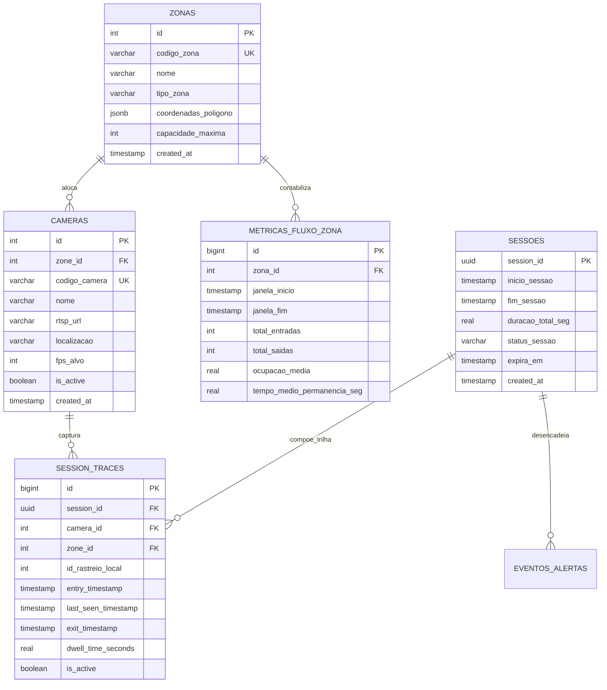

# 06. MODELAGEM DO BANCO DE DADOS (POSTGRESQL & SCHEMAS)

> **⚠ ADAPTAÇÃO OBRIGATÓRIA (revisado em 2026-10-21) — SCHEMA PARCIALMENTE SUPERADO.**
> **NÃO implementar** as tabelas `sessoes` e `session_traces` (e nenhuma tabela/coluna por-pessoa: sem track_id, rota, embedding) — persistem trilha individual = perfil comportamental (LGPD art. 12 §2º). Implementar apenas: tabelas de configuração (`cameras`, `zonas`) + métricas agregadas (`metricas_fluxo_zona`, agregados de dwell com histograma, buckets de heatmap). Eventos de ocupação: somente zona, contagem, % de área e timestamp de janela — **sem chave de pessoa**. Fonte do escopo vigente: `../REQUIREMENTS.md` (requisitos canônicos) e `../ROADMAP.md` (fases canônicas).
>
> As entidades `SESSOES`, `SESSION_TRACES` e `EVENTOS_ALERTAS` estão neste documento **apenas como registro histórico do desenho original** — estão marcadas com 🚫 e **não devem ser criadas**. O schema que de fato vai para o banco está na seção 2.1.

## 1. Modelo Entidade-Relacionamento (MER)



> 🚫 **Entidades vetadas neste diagrama (NÃO criar no banco):** `SESSOES`, `SESSION_TRACES` e `EVENTOS_ALERTAS`. As duas primeiras persistem trilha individual e identificador de rastreamento (perfil comportamental — art. 12 §2º); a terceira dispararia alertas a partir de sessões. O diagrama acima é preservado apenas como registro do desenho original.

---

## 2. Schema SQL Completo (PostgreSQL)

```sql
-- Extensões necessárias
CREATE EXTENSION IF NOT EXISTS "uuid-ossp";
CREATE EXTENSION IF NOT EXISTS "pgcrypto";

-- 1. Zonas do Hotel
CREATE TABLE IF NOT EXISTS zonas (
    id SERIAL PRIMARY KEY,
    codigo_zona VARCHAR(50) UNIQUE NOT NULL,
    nome VARCHAR(100) NOT NULL,
    tipo_zona VARCHAR(50) DEFAULT 'monitoramento',
    coordenadas_poligono JSONB DEFAULT '[]'::JSONB,
    capacidade_maxima INT DEFAULT 100,
    created_at TIMESTAMP WITH TIME ZONE DEFAULT CURRENT_TIMESTAMP
);

-- 2. Câmeras com Mapeamento de Zona
CREATE TABLE IF NOT EXISTS cameras (
    id SERIAL PRIMARY KEY,
    zone_id INT REFERENCES zonas(id) ON DELETE SET NULL,
    codigo_camera VARCHAR(50) UNIQUE NOT NULL,
    nome VARCHAR(100) NOT NULL,
    rtsp_url VARCHAR(255),
    localizacao VARCHAR(100) NOT NULL,
    fps_alvo INT DEFAULT 30,
    is_active BOOLEAN DEFAULT TRUE,
    created_at TIMESTAMP WITH TIME ZONE DEFAULT CURRENT_TIMESTAMP
);
CREATE INDEX IF NOT EXISTS idx_cameras_zone ON cameras(zone_id);

-- 3. Métricas Agregadas e Anonimizadas (Conforme LGPD Art. 12)
CREATE TABLE IF NOT EXISTS metricas_fluxo_zona (
    id BIGSERIAL PRIMARY KEY,
    zona_id INT NOT NULL REFERENCES zonas(id) ON DELETE CASCADE,
    janela_inicio TIMESTAMP WITH TIME ZONE NOT NULL,
    janela_fim TIMESTAMP WITH TIME ZONE NOT NULL,
    ocupacao_media REAL DEFAULT 0.0,
    pct_area_media REAL DEFAULT 0.0,
    criado_em TIMESTAMP WITH TIME ZONE DEFAULT CURRENT_TIMESTAMP
);
CREATE INDEX IF NOT EXISTS idx_metricas_tempo ON metricas_fluxo_zona(zona_id, janela_inicio);
```

### 2.1 🚫 Blocos vetados — NÃO EXECUTAR

O trecho abaixo veio do desenho original do projeto e **não deve ser aplicado**: mantém trilha individual e TTL de sessão.

```sql
-- 🚫 VETADO — "Sessões Globais com Expiração (TTL)": persiste sessão por pessoa
CREATE TABLE IF NOT EXISTS sessoes (
    session_id UUID PRIMARY KEY DEFAULT gen_random_uuid(),
    inicio_sessao TIMESTAMP WITH TIME ZONE NOT NULL DEFAULT CURRENT_TIMESTAMP,
    fim_sessao TIMESTAMP WITH TIME ZONE DEFAULT NULL,
    duracao_total_seg REAL DEFAULT 0.0,
    status_sessao VARCHAR(30) DEFAULT 'ativa',
    expira_em TIMESTAMP WITH TIME ZONE NOT NULL DEFAULT (CURRENT_TIMESTAMP + INTERVAL '1 day'),
    created_at TIMESTAMP WITH TIME ZONE DEFAULT CURRENT_TIMESTAMP
);
CREATE INDEX IF NOT EXISTS idx_sessoes_status ON sessoes(status_sessao, expira_em);

-- 🚫 VETADO — "Trilha de Permanência por Câmera / Zona": persiste id_rastreio_local
CREATE TABLE IF NOT EXISTS session_traces (
    id BIGSERIAL PRIMARY KEY,
    session_id UUID NOT NULL REFERENCES sessoes(session_id) ON DELETE CASCADE,
    camera_id INT NOT NULL REFERENCES cameras(id) ON DELETE CASCADE,
    zone_id INT REFERENCES zonas(id) ON DELETE SET NULL,
    id_rastreio_local INT NOT NULL,
    entry_timestamp TIMESTAMP WITH TIME ZONE NOT NULL,
    last_seen_timestamp TIMESTAMP WITH TIME ZONE NOT NULL,
    exit_timestamp TIMESTAMP WITH TIME ZONE DEFAULT NULL,
    dwell_time_seconds REAL GENERATED ALWAYS AS (
        EXTRACT(EPOCH FROM (COALESCE(exit_timestamp, last_seen_timestamp) - entry_timestamp))
    ) STORED,
    confianca_media REAL DEFAULT 0.0,
    is_active BOOLEAN DEFAULT TRUE,
    CONSTRAINT uq_session_camera_active UNIQUE (session_id, camera_id, is_active)
);
```

### 2.2 Schema conforme (Fases 3 e 7 — a implementar)

```sql
-- Agregados de permanência (dwell) por zona x janela — NUNCA linha por pessoa
CREATE TABLE IF NOT EXISTS dwell_agregado_zona (
    id BIGSERIAL PRIMARY KEY,
    zona_id INT NOT NULL REFERENCES zonas(id) ON DELETE CASCADE,
    janela_inicio TIMESTAMP WITH TIME ZONE NOT NULL,
    janela_fim TIMESTAMP WITH TIME ZONE NOT NULL,
    n_permanencias INT NOT NULL DEFAULT 0,
    soma_segundos BIGINT NOT NULL DEFAULT 0,
    min_segundos INT,
    max_segundos INT,
    histograma JSONB DEFAULT '{"0-2min": 0, "2-5min": 0, "5-15min": 0, "15+min": 0}'::JSONB,
    criado_em TIMESTAMP WITH TIME ZONE DEFAULT CURRENT_TIMESTAMP
);
CREATE INDEX IF NOT EXISTS idx_dwell_janela ON dwell_agregado_zona(zona_id, janela_inicio);

-- Buckets de heatmap de densidade (célula x janela) — posições efêmeras somadas
CREATE TABLE IF NOT EXISTS heatmap_densidade_camada (
    id BIGSERIAL PRIMARY KEY,
    camera_id INT NOT NULL REFERENCES cameras(id) ON DELETE CASCADE,
    janela_inicio TIMESTAMP WITH TIME ZONE NOT NULL,
    janela_fim TIMESTAMP WITH TIME ZONE NOT NULL,
    grade_x INT NOT NULL,
    grade_y INT NOT NULL,
    contador INT NOT NULL DEFAULT 0,
    criado_em TIMESTAMP WITH TIME ZONE DEFAULT CURRENT_TIMESTAMP
);
CREATE INDEX IF NOT EXISTS idx_heatmap_janela ON heatmap_densidade_camada(camera_id, janela_inicio);
```

**Invariante verificável em auditoria (PRV-01, Fase 9):** nenhuma tabela do schema final pode conter coluna `session_id`, `track_id`, `id_rastreio_local`, `embedding`, `rota` ou `jornada`, nem uma linha por pessoa.
