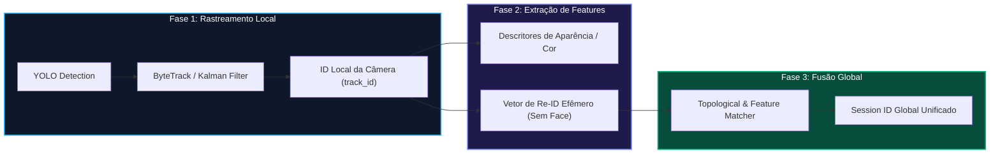

# 05. RASTREAMENTO MULTI-CÂMERAS (MTMCT) E RE-IDENTIFICAÇÃO

> **⚠ DOCUMENTO SUPERADO (2026-10-08) — NÃO IMPLEMENTAR.**
> MTMCT, Re-ID, fusão de trilhas e qualquer associação entre câmeras estão **FORA DO ESCOPO PARA SEMPRE** (LGPD art. 12 §2º — reconstruir rotas = perfil comportamental; ordem explícita do usuário: "câmera 2 nunca pode reconhecer alguém da câmera 1, nem por silhueta"). Este documento permanece apenas como referência histórica/research. O rastreamento permitido é **intra-câmera, em RAM, segundos** (ByteTrack), nunca persistido. Fonte do escopo vigente: `../REQUIREMENTS.md` (requisitos canônicos) e `../ROADMAP.md` (fases canônicas).

## 1. O Desafio do Rastreamento Multi-Câmeras (MTMCT)
Em um hotel com dezenas de câmeras, um hóspede entra pela porta principal (Cam 1), faz check-in no balcão (Cam 2), pega o elevador no 1º andar (Cam 4) e vai ao seu quarto (Cam 5).

O **MTMCT (Multi-Target Multi-Camera Tracking)** é o subsistema responsável por correlacionar que essas 4 aparições pertencem à **mesma jornada (session_id)**, sem gerar 4 contagens isoladas e incorretas.

---

## 2. Pipeline de Rastreamento em 3 Fases

---

## 3. Mecanismos de Associação e Lógica Espaço-Temporal

Para evitar falsas associações entre câmeras, o sistema combina:
1. **Restrição Topológica (Espaço-Tempo):** Uma pessoa que acabou de ser vista saindo da recepção não pode aparecer 2 segundos depois na piscina (distância física inviável).
2. **Similaridade de Aparência:** Comparação por distância cosseno entre vetores visuais de vestimenta/cores.
3. **Timeout de Desconexão (TTL em RAM):** Se o indivíduo não for visto em nenhuma câmera adjacente após 15 minutos, a sessão é finalizada e o buffer de memória é liberado.
