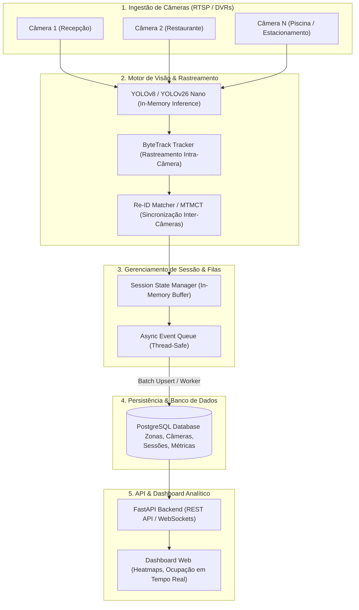

# 02. ARQUITETURA TÉCNICA E ENGENHARIA DO SISTEMA

> **⚠ Escopo vigente:** esta arquitetura vale exceto módulos de face/catraca e MTMCT (fora do escopo para sempre). Invariantes: zero tracking entre câmeras, frames nunca em disco, saída só agregada. Ver `../PLANO_V1_COMPLETO.md` e o aviso no `README.md`.

## 1. Visão Geral da Arquitetura em 5 Camadas

---

## 2. Detalhamento dos Componentes

### 1. Ingestão RTSP (DVRs)
- **Protocolo:** RTSP sobre TCP/UDP (`rtsp://usuario:senha@ip_dvr:554/cam/realmonitor?channel=1&subtype=0`).
- **Resolução de Ingestão:** 720p ou 1080p com sub-stream a 15–30 FPS para balancear carga de processamento.
- **Resiliência:** Mecanismo de reconexão automática em caso de queda de pacote de rede.

### 2. Motor de Visão (YOLO + ByteTrack)
- **Inferência:** PyTorch / TensorRT em GPU NVIDIA (RTX 3060/4060 ou superior).
- **Tempo de Execução:** ~3.1 ms por frame (~320 FPS na GPU para um único stream, permitindo multiplexar 8 a 16 câmeras com skip de frames).
- **Rastreamento Local:** Algoritmo ByteTrack associando caixas delimitadoras entre quadros sucessivos para formar trilhas contínuas.

### 3. Fila Assíncrona & Persistência
- **Buffer de Eventos:** Para evitar gargalos de I/O de banco de dados a cada frame, os eventos de entrada/saída são acumulados em memória e gravados em lote (`batch upsert`) a cada poucos segundos.
- **Banco Relacional:** PostgreSQL com suporte a JSONB para armazenar polígonos de zonas e coordenadas.

### 4. API & Dashboard
- **FastAPI:** Endpoints REST para consulta de ocupação atual (`/api/v1/zonas/{id}/ocupacao`) e séries temporais de fluxo.
- **Logs de Acesso:** Guarda compulsória de logs de requisição por 6 meses para cumprimento do Art. 15 do Marco Civil.
