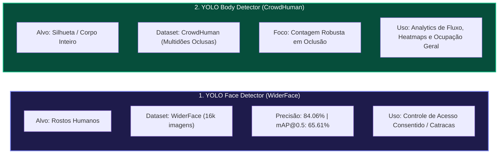

# 04. MODELOS DE INTELIGÊNCIA ARTIFICIAL: FACE VS. CORPO (BODY)

> **⚠ DOCUMENTO SUPERADO (2026-10-08) — NÃO SEGUIR A PARTE DE FACE.**
> Escopo vigente (aprovado pelo usuário): **apenas detecção de corpo (CrowdHuman)**. Face/reconhecimento/biometria estão **FORA DO ESCOPO PARA SEMPRE** (LGPD art. 11 — dado sensível sem base legal para analytics; decisão do usuário). Este documento permanece apenas como histórico técnico da comparação de modelos. Fonte do escopo vigente: `PLANO_V1_COMPLETO.md` e `09_PLANO_DE_FASES_V1.md`.

## 1. Visão Geral dos Modelos Treinados no Projeto

O projeto desenvolveu e avaliou duas abordagens de detecção computacional para atender tanto a alta precisão técnica quanto às restrições regulatórias da LGPD:

---

## 2. Métricas Consolidadas do Modelo de Detecção Facial

O modelo de detecção facial foi refinado a partir do YOLO Nano com resolução de entrada de `512px` e funções de perda customizadas (`box=10.0`, `cls=0.7`, `dfl=2.0`):

| Métrica | Treino Baseline (320px) | Treino Otimizado (512px) | Ganho Absoluto | Ganho Relativo |
| :--- | :---: | :---: | :---: | :---: |
| **Precisão (Precision)** | 77.82% | **84.06%** | +6.24% | **+8.01%** |
| **Sensibilidade (Recall)** | 47.44% | **58.84%** | +11.39% | **+24.01%** |
| **mAP @ 0.5** | 52.65% | **65.61%** | +12.96% | **+24.62%** |
| **mAP @ 0.5:0.95** | 26.66% | **34.81%** | +8.16% | **+30.59%** |
| **F1-Score Harmônico** | 58.81% | **69.10%** | +10.29% | **+17.49%** |
| **Velocidade na GPU** | ~3.5 ms | **~3.1 ms** | — | **~320 FPS** |

---

## 3. A Transição Estratégica: Detecção de Corpo (Person Tracking)

Para operações em áreas públicas e de circulação comum (restaurante, piscina, corredores), o projeto utiliza o detector de **corpo inteiro (CrowdHuman)**:
- **Vantagem Técnica:** Não sofre degradação de acurácia quando o indivíduo está de costas, usando boné, máscara ou óculos escuros.
- **Vantagem Regulatória:** **Não extrai dados biométricos sensíveis**, descaracterizando o risco de multas da LGPD e permitindo contagem 100% anonimizada em tempo real.
