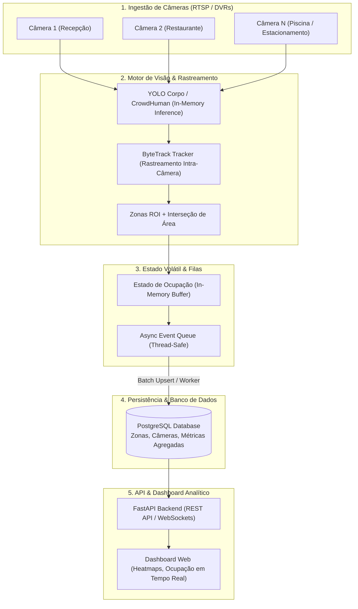
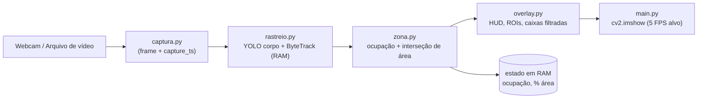

# 02. ARQUITETURA TÉCNICA E ENGENHARIA DO SISTEMA

> **⚠ Escopo vigente (2026-10-21):** esta arquitetura vale **exceto** os módulos de face/catraca, MTMCT/Re-ID e sessões persistidas — todos **fora do escopo para sempre**. Invariantes: zero tracking entre câmeras, frames nunca em disco, saída só agregada.
> Ver `../PLANO_V1_COMPLETO.md` e o aviso no `README.md` desta pasta.
>
> Documento normativo vivo. Última atualização: **2026-10-21**.

---

## 1. Arquitetura-Alvo (5 camadas — Fases 3 a 7, ainda não implementada)

> 🔒 **Vedado neste diagrama (e ausente do código):** Re-ID Matcher / MTMCT (sincronização inter-câmeras), Re-ID por silhueta/aparência, "Session Manager" de trilhas individuais e tabelas `sessoes`/`session_traces` no banco. A camada 3 é um **buffer de estado em RAM**, não um gerenciador de sessões persistidas. A camada 4 guarda **só configuração e métricas agregadas**.

---

## 2. Arquitetura Implementada (Fases 1 e 2 — estado real em 2026-10-21)

| Módulo | Responsabilidade | Linhas |
|---|---|---|
| `main.py` | Orquestração: resolve modelo e fonte, carrega zonas, loop de vídeo a 5 FPS, wiring do overlay | 124 |
| `captura.py` | Abre a fonte (webcam por índice ou arquivo) e carimba `capture_ts` na captura | 19 |
| `rastreio.py` | YOLO corpo + ByteTrack efêmero (`classes=[0]`); devolve `(id, (x1,y1,x2,y2), conf)` | 23 |
| `zona.py` | Carrega/valida ROIs, calcula ocupação por zona e **interseção de área**, resets e reconciliação | 313 |
| `overlay.py` | Desenha ROIs, interseção em destaque, caixas **filtradas por ROI**, cards de ocupação e HUD de FPS | 129 |
| `entender_zonas.py` | Utilitário: gera `zonas_visualizacao.png` a partir do YAML (sem rodar vídeo) | 76 |

**Nenhum passo do pipeline escreve em disco.** O frame é desenhado in-place e exibido; o estado de ocupação vive em RAM e é recalculado a cada frame.

---

## 3. Detalhamento dos Componentes

### 1. Ingestão (Fase 6 — planejada)
- **Protocolo:** RTSP sobre TCP/UDP (`rtsp://usuario:senha@ip_dvr:554/cam/realmonitor?channel=1&subtype=0`).
- **Resolução de ingestão:** 720p ou 1080p com sub-stream a 15–30 FPS para balancear carga de processamento.
- **Biblioteca:** **PyAV**, não OpenCV — o `cv2.VideoCapture` corrompe frames RTSP após 15–35 s (consta na pesquisa de 2026-10-08).
- **Resiliência:** reconexão automática com backoff exponencial + watchdog de staleness.
- **Estado atual:** apenas webcam e arquivo local (`cv2.VideoCapture`), uma câmera por execução.

### 2. Motor de Visão (YOLO + ByteTrack) — implementado
- **Modelo:** YOLO nano (`yolo26n.pt` como fallback) ou o detector de corpo treinado em CrowdHuman (`resultados/best.pt`), resolvidos por ordem de prioridade em `main.py`.
- **Inferência:** GPU NVIDIA; latência-alvo $\le 5\text{ ms}$ por frame (QUA-01).
- **Rastreamento local:** ByteTrack associando caixas entre quadros sucessivos para formar trilhas **efêmeras** (RAM, ≤ 15 s, podadas após 60 frames sem sighting).
- **Restrição:** cada câmera tem seu **próprio** tracker; não existe código que compare câmera 1 com câmera 2.

### 3. Zonas, Ocupação e Interseção de Área — implementado
- **ROIs poligonais** por câmera em `config/zonas.yaml`, com `capacidade` como teto físico.
- **Ocupação:** recontagem por frame (pé, centro ou sobreposição de borda dentro do polígono), com clamp `[0, capacidade]`.
- **Interseção de área:** `Interseção = Área(Objeto) ∩ Área(ROI)` → percentual de área ocupada, exibido no overlay.
- **Estabilidade:** reset diário (meia-noite local), reset por inatividade (> 10 min vazia), reconciliação total ao reabrir a fonte.

### 4. Fila Assíncrona & Persistência (Fase 3 — planejada)
- **Buffer de eventos:** para evitar gargalo de I/O a cada frame, os eventos agregados são acumulados em memória RAM e gravados em lote (`batch upsert`) a cada N eventos ou T segundos, com UUID por lote (idempotência).
- **Banco relacional:** PostgreSQL com JSONB para polígonos de zonas, guardando **somente** tabelas de configuração (câmeras, zonas) e métricas agregadas (`metricas_fluxo_zona`, agregados de dwell, buckets de heatmap).

### 5. API & Dashboard (Fases 4 e 5 — planejadas)
- **FastAPI:** endpoints somente-leitura para ocupação atual (`/api/v1/zonas/{id}/ocupacao`), séries temporais, histogramas e heatmap agregado; WebSocket para a ocupação ao vivo.
- **Logs de acesso:** guarda compulsória por **6 meses** sob sigilo, com o mínimo funcional (IP, data/hora, ação) — Marco Civil art. 15.

---

## 4. Stack

| Camada | Implementado hoje | Planejado (Fases 3–7) |
|---|---|---|
| Linguagem | Python 3.14.4 (venv `.venv/`) | — |
| Visão / tracking | `ultralytics==8.4.121` (YOLO + ByteTrack) | — |
| Imagem / matemática | `opencv-python==5.0.0.93`, `numpy==2.5.2`, `lap==0.5.13` | — |
| Configuração | `pyyaml==6.0.3` | — |
| Ingestão RTSP | `cv2.VideoCapture` (webcam/arquivo) | **PyAV** + **MediaMTX** (RTSP local de teste) |
| Persistência | — | **PostgreSQL 18** + `asyncpg` |
| API | — | **FastAPI** + WebSocket |
| Dashboard | — | **React** + **Vite** + **ECharts** |
| Ambiente | venv local | **docker-compose** (PostgreSQL + API + dashboard) |
| Testes | `pytest>=8.0` (`requirements-dev.txt`) | + acurácia vs. marcação manual |
